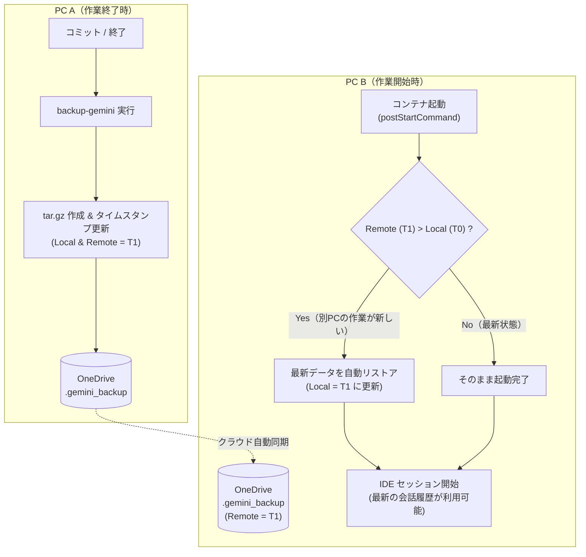

# devcontainer-scripts

OneDrive 等のクラウドストレージで共有されたワークスペースを複数の PC から Dev Container（VS Code / Antigravity IDE）として開く際に、**会話履歴・エージェントデータ・シェル履歴を安全かつシームレスに同期・永続化するユーティリティスクリプト群**です。

---

## 💡 解決する課題

1. **Docker Named Volume が PC 間で共有されない問題**
   - Dev Container 内のエージェントデータ（`~/.gemini`）やシェル履歴は、通常 Docker の Named Volume に保存されます。
   - Named Volume は各 PC（Docker ホスト）のローカルに閉じるため、OneDrive でプロジェクトフォルダを共有していても、別 PC で開くと会話履歴や作業コンテキストが引き継がれません。
2. **クラウド同期特有の「先祖返り」や「競合・破損」リスク**
   - 複数 PC で作業していると、「古い PC 側で誤って古いバックアップをクラウドに上書きしてしまう」先祖返り事故が起きがちです。
   - OneDrive 等のクラウド同期の書き込み途中に tar アーカイブを展開しようとしてファイル破損が起きるリスクもあります。
3. **開発環境のセットアップ工数**
   - コンテナを作成するたびに Git の設定（`user.name`、`safe.directory`、ページャー停止対策）やコマンド履歴の引き継ぎを手動で行う必要があります。

**本プロジェクトは、タイムスタンプによる分散新旧判定・逆流防止ガード・自動セットアップにより、これらの問題をすべて解決します。**

---

## ✨ 主な機能

### 1. タイムスタンプ同期 & 逆流防止ガード
- **分散タイムスタンプ比較**:
  OneDrive 側の `.gemini_backup/.last_backup_timestamp` とコンテナローカルの `/var/gemini-data/.last_backup_timestamp` を比較。
- **自動同期（リストア）**:
  別 PC で作成された新しいバックアップを検知した場合、コンテナ起動時に自動で最新データを展開。
- **誤上書きの完全防止**:
  別 PC のバックアップの方が新しい場合、古いローカルデータによる上書きバックアップを自動でブロックします（`--force` で強制可能）。

### 2. エージェントデータ & シェル履歴の永続化
- `~/.gemini`（会話履歴、brain、要約データベース等）を `/var/gemini-data` へマウント・シンボリックリンク化。
- Bash（`~/.bash_history`）および Zsh（`~/.zsh_history`）のコマンド履歴を永続化し、コンテナを破棄・再作成しても履歴（`Ctrl+R`）を維持。

### 3. Git & 開発環境の自動最適化
- **ホストの Git 設定自動同期**: ホストの `~/.gitconfig` から `user.name` と `user.email` を読み取り、コンテナ内に自動適用。
- **Git トラブル防止策の自動設定**:
  - `safe.directory`: Docker マウント時の所有権不一致（exit code 128）を防止。
  - `core.pager = cat`: コミットログ表示時のターミナルハングを防止。
  - `core.fileMode = false`: Windows/WSL/Linux 間の実行権限差分による意図しない Git 変更検知を抑制。
  - `core.editor = vi`: リベースやコミットメッセージ入力時の対話型エディタを確保。
- **Git post-commit フック**: `git commit` 成功時にバックグラウンドで自動バックアップを実行。
- **`node_modules` 所有権調整**: Named Volume マウント時に root 所有となってしまう問題を自動解決。

### 4. 堅牢なバックアップアーキテクチャ
- **アトミック書き込み**: 一時ファイル（`.tmp.<pid>`）に書き出してからアトミックに移動（`mv`）することで、OneDrive の同期途中書き込み事故を防止。
- **リストア前の整合性テスト**: `tar -tzf` でアーカイブ破損や同期中状態を検知し、安全が確認された場合のみ展開。
- **超軽量アーカイブ**: 実行バイナリ、キャッシュ、ソケット、一時ログなどを自動除外。

---

## 🔄 同期とライフサイクルの仕組み



---

## 📁 ファイル構成

```text
devcontainer-scripts/
├── backup-gemini.sh          # バックアップ/リストア/同期の統合CLI
├── setup-gemini.sh           # コンテナ初回作成時の自動構成スクリプト
├── rebuild_conversations.py  # （保守用）会話履歴インデックス再構築スクリプト
├── .devcontainer/
│   ├── devcontainer.json     # Dev Container 設定定義
│   └── devcontainer-lock.json
├── .gemini_backup/           # [同期対象] バックアップ格納ディレクトリ
│   ├── gemini-data-latest.tar.gz
│   └── .last_backup_timestamp
└── README.md
```

---

## 🚀 使い方

### 1. CLI コマンド (`backup-gemini`)

コンテナ内のターミナルで `backup-gemini` コマンドが利用可能です。

| コマンド | 説明 |
| :--- | :--- |
| `backup-gemini` | 即時バックアップを実行（リモートが新しい場合は安全のためブロック） |
| `backup-gemini --sync` | リモートバックアップが新しい場合（または新規環境）に自動リストア |
| `backup-gemini --auto` | 自動判定：リモートが新しければ同期、自ローカルが古ければ12時間経過でバックアップ |
| `backup-gemini --restore` | タイムスタンプ比較をスキップし、アーカイブから強制リストア |
| `backup-gemini --force` | リモートの新旧判定を無視し、ローカルデータで強制バックアップ |
| `backup-gemini --check` | 環境の健全性チェック（自己診断）を実行 |

### 2. 環境の自己診断（ヘルスチェック）

開発環境や同期状態が正常であるかをワンアクションで確認できます。

```bash
backup-gemini --check
```

**出力例:**
```text
=== [setup-gemini] Environment Health Check ===
 [OK] ~/.gemini -> /var/gemini-data
 [OK] ~/.bash_history -> /var/gemini-data/commandhistory/.bash_history
 [OK] 'backup-gemini' CLI is available: /usr/local/bin/backup-gemini
 [OK] Git safe.directory is registered (/workspaces/devcontainer-scripts)
 [OK] Git core.pager is 'cat' (pager hang protection enabled)
 [OK] Git core.fileMode is 'false' (file mode diff ignored)
 [OK] Git core.editor is 'vi'
 [OK] Git post-commit hook is installed and executable
 [OK] node_modules exists (owner: node:node)
 [OK] Git user configured: username <user@example.com>
 [OK] Backup timestamps in sync (Timestamp: 1793535194)
===============================================
All essential configurations are healthy!
```

---

## 🛠️ 他のプロジェクト（Dev Container）への組み込み手順

他の Dev Container プロジェクトでこの仕組みを利用する場合、以下の手順で簡単に導入できます。

### 1. `devcontainer.json` の設定

プロジェクトの `.devcontainer/devcontainer.json` に以下の設定を追加します：

```jsonc
{
  "name": "my-project",
  "image": "mcr.microsoft.com/devcontainers/javascript-node:24-bookworm",
  
  "mounts": [
    // 1. 各PCローカルで独立したNamed Volumeを用意
    "source=devcontainer-gemini-data-${devcontainerId},target=/var/gemini-data,type=volume",
    "source=devcontainer-node_modules-${devcontainerId},target=${containerWorkspaceFolder}/node_modules,type=volume",
    // 2. ホストのGit設定をReadOnlyでマウント
    "source=${localEnv:HOME}${localEnv:USERPROFILE}/.gitconfig,target=/var/host-gitconfig,type=bind,readonly",
    // 3. 共通スクリプト（本リポジトリ）をマウント
    "source=${localEnv:SystemDrive}${localEnv:HOME}/OneDrive/Omochi/devcontainer-scripts,target=/var/devcontainer-scripts,type=bind"
  ],

  // コンテナ初回作成時に環境を初期構築
  "postCreateCommand": "if [ -f /var/devcontainer-scripts/setup-gemini.sh ]; then bash /var/devcontainer-scripts/setup-gemini.sh; fi",

  // コンテナ起動直後（IDE接続前）に、別PCの最新バックアップがあれば同期リストア
  "postStartCommand": "if command -v backup-gemini >/dev/null 2>&1; then backup-gemini --sync; elif [ -f /var/devcontainer-scripts/backup-gemini.sh ]; then bash /var/devcontainer-scripts/backup-gemini.sh --sync; fi",

  // エディタアタッチ時にバックグラウンドで定期バックアップ判定
  "postAttachCommand": "backup-gemini --auto > /dev/null 2>&1 &"
}
```

### 2. `.gitignore` の設定

バックアップデータ（`.gemini_backup`）は OneDrive 等のクラウドストレージで同期するため、Git リポジトリにはコミットしないよう設定します：

```gitignore
# .gitignore
.gemini_backup/
```

---

## 🔒 セーフティ機能一覧

| 発生しうる事故 | 本システムの対策 |
| :--- | :--- |
| **古いPCで開いて作業し、最新バックアップを上書き** | バックアップ前にタイムスタンプを比較。リモートが新しい場合はバックアップをエラー終了させてブロック。 |
| **PC起動時にDBやプロセスと競合してリストア失敗** | IDE がセッションを開始する前の `postStartCommand` フェーズで `--sync` を同期実行。 |
| **OneDrive の同期途中で不完全な tar.gz を解凍** | `tar -tzf` で整合性を事前検証。破損や同期中の場合はリストアを中断。 |
| **バックアップ作成中のクラッシュ・書き込み途中同期** | 一時ファイル（`.tmp.<pid>`）にアーカイブを生成後、`mv` によるアトミック更新を実施。 |

