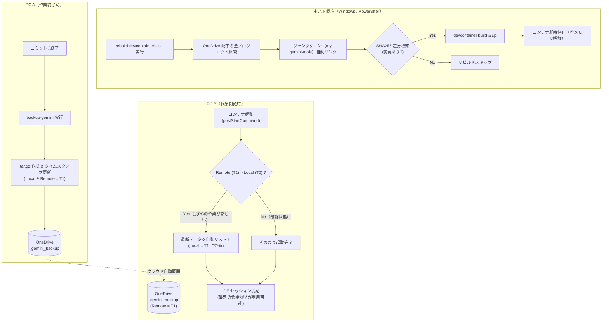

# devcontainer-scripts

OneDrive 等のクラウドストレージ配下に散らばる複数の Dev Container プロジェクトを一元管理し、**共通環境（エージェントデータ同期、シェル履歴、Git 設定）の標準化**と、**差分検知付き省メモリ一括自動リビルド**を実現するための包括的なツールセットです。

---

## 💡 解決する課題

1. **Docker Named Volume が PC 間で共有されない問題**
   - Dev Container 内のエージェントデータ（`~/.gemini`）やシェル履歴は、通常 Docker の Named Volume に保存されます。
   - Named Volume は各 PC（Docker ホスト）のローカルに閉じるため、OneDrive でプロジェクトフォルダを共有していても、別 PC で開くと会話履歴や作業コンテキストが引き継がれません。
2. **クラウド同期特有の「先祖返り」や「競合・破損」リスク**
   - 複数 PC で作業していると、「古い PC 側で誤って古いバックアップをクラウドに上書きしてしまう」先祖返り事故が起きがちです。
   - OneDrive 等のクラウド同期の書き込み途中に tar アーカイブを展開しようとしてファイル破損が起きるリスクもあります。
3. **各プロジェクトでの設定重複と肥大化**
   - プロジェクトごとに `devcontainer.json` へ共通のマウント設定や初期化スクリプトをコピー＆ペーストしていると、設定更新時のメンテナンスが破綻します。
4. **大量プロジェクトの一括リビルドによる PC メモリ枯渇**
   - 多数の Dev Container をまとめてリビルドすると、起動したコンテナがメモリを消費し続け、PC の動作が重くなります。

---

## 📁 フォルダ・ファイル構成

```text
devcontainer-scripts/
├── .github/
│   └── workflows/
│       └── release.yaml        # [CI/CD] GHCR 自動公開ワークフロー
├── docs/
│   └── docker-cli-hints-troubleshooting.md # [備忘録] Docker CLI Hints 非表示化と Feature バージョン管理
├── windows/                    # [Host] Windows エクスプローラー右クリック拡張（直通起動）
│   ├── OpenAntigravityDevContainer.reg
│   ├── OpenVSCodeDevContainer.reg
│   ├── RemoveAntigravityDevContainer.reg
│   ├── RemoveVSCodeDevContainer.reg
│   └── README.md
├── src/
│   └── my-gemini-tools/        # 全プロジェクト共通の自作 Dev Container Feature
│       ├── devcontainer-feature.json
│       └── install.sh
├── rebuild-devcontainers.ps1   # [Host] 差分検知 ＆ 自動停止（省メモリ）一括リビルドスクリプト
├── sync-configs.ps1            # [Host] devcontainer.json の集約・一括編集・逆反映（Pull/Push）
├── backup-gemini.sh            # [Container] バックアップ/リストア/同期の統合CLI
├── setup-gemini.sh             # [Container] 初回作成時の環境自動構成スクリプト
├── .devcontainer/
│   ├── devcontainer.json       # Dev Container 設定定義
│   └── devcontainer-lock.json
├── .gemini_backup/             # [同期対象] バックアップ格納ディレクトリ
│   ├── gemini-data-latest.tar.gz
│   └── .last_backup_timestamp
└── README.md
```

---

## ✨ コア機能と仕組み

### 1. 共通設定の Feature 化 (`my-gemini-tools`)
各プロジェクトで重複していた共通設定を、独自の **Dev Container Feature** としてカプセル化しています。

- **共通マウント (`mounts`)**:
  - `devcontainer-gemini-data-${devcontainerId}`（Gemini データ永続化ボリューム）
  - `devcontainer-node_modules-${devcontainerId}`（node_modules 用ボリューム）
  - ホストの `~/.gitconfig`（リードオンリー）
  - OneDrive 上の共通スクリプト（`OneDrive/Omochi/devcontainer-scripts`）
- **ライフサイクルフック**:
  - `postCreateCommand`: Gemini のセットアップスクリプト自動実行（`setup-gemini.sh`）
  - `postStartCommand`: `backup-gemini --sync` による起動時同期リストア
  - `postAttachCommand`: `backup-gemini --auto` のバックグラウンド定期バックアップ

### 2. GHCR によるクラウド自動配布 ＆ ローカルコピー対応
- **GHCR（推奨・標準）**:
  GitHub Container Registry に公開されているため、各プロジェクトの `devcontainer.json` に URL を 1 行書くだけで、ジャンクションやローカル配置なしにどの PC からでも自動ダウンロード・適用されます。
- **ローカル実体コピー (`-LocalFeature`)**:
  手元で Feature を改修・試作したい場合、`rebuild-devcontainers.ps1 -LocalFeature` を実行することで、各プロジェクトの `.devcontainer/my-gemini-tools` へ実体コピーを安全に同期できます（※Windows のジャンクションは Docker ビルド時にリンクが見失われてエラーとなるため、実体コピー方式を採用しています）。

### 3. 差分検知 ＆ 省メモリ自動停止リビルド (`rebuild-devcontainers.ps1`)
- **SHA256 ハッシュによる差分検知**:
  `.devcontainer` 配下のファイル（ジャンクション先の Feature 含む）からハッシュを算出し、変更があったプロジェクトのみをリビルドします。
- **メモリ解放（自動停止）**:
  リビルド完了後、起動したコンテナを即座に安全停止させ、大量のプロジェクトがあっても PC のメモリを圧迫しません。

### 4. タイムスタンプ同期 & 逆流防止ガード
- **分散タイムスタンプ比較**:
  OneDrive 側の `.gemini_backup/.last_backup_timestamp` とコンテナローカルの `/var/gemini-data/.last_backup_timestamp` を比較。
- **起動時自動同期（リストア）**:
  別 PC で作成された新しいバックアップを検知した場合、コンテナ起動時（IDE接続前）に自動で最新データを展開。
- **誤上書きの完全防止**:
  別 PC のバックアップの方が新しい場合、古いローカルデータによる上書きバックアップを自動でブロックします（`--force` で強制可能）。

### 5. エージェントデータ & シェル履歴 & Git の自動最適化
- **会話履歴とシェル履歴の永続化**:
  `~/.gemini`（会話履歴、brain、要約 DB 等）および Bash（`~/.bash_history`）・Zsh（`~/.zsh_history`）をボリュームへマウント。コンテナを破棄・再作成しても履歴（`Ctrl+R`）が残ります。
- **ホストの Git 設定自動同期**:
  ホストの `~/.gitconfig` から `user.name` と `user.email` を読み取り、コンテナ内に自動適用。
- **Git トラブル防止策の自動設定**:
  - `safe.directory`: Docker マウント時の所有権不一致（exit code 128）を防止。
  - `core.pager = cat`: コミットログ表示時のターミナルハングを防止。
  - `core.fileMode = false`: OS 間の実行権限差分による意図しない Git 変更検知を抑制。
  - `core.editor = vi`: リベースやコミットメッセージ入力時の対話型エディタを確保。
- **Git post-commit フック**: `git commit` 成功時に自動バックアップを実行（安全な同期実行・多重起動防止・一時ファイル自動掃除）。
- **パッケージ自動インストール**: ワークスペースに `package.json` が存在する場合、`node_modules` の所有権を調整した上で自動的に `npm install` を実行。

### 6. 堅牢なバックアップアーキテクチャ
- **アトミック書き込み**: 一時ファイル（`.tmp.<pid>`）に書き出してからアトミックに移動（`mv`）することで、OneDrive の同期途中書き込み事故を防止。
- **リストア前の整合性テスト**: `tar -tzf` でアーカイブ破損や同期中状態を検知し、安全が確認された場合のみ展開。
- **超軽量アーカイブ**: 実行バイナリ、キャッシュ、ソケット、一時ログなどを自動除外。

---

## 🔄 同期とライフサイクルの仕組み



---

## 🛠️ 各プロジェクトでの書き方（移行手順）

各プロジェクトの `devcontainer.json` では、共通の `mounts` や `backup-gemini` 関連のコマンドを削除し、`features` に `"./my-gemini-tools": {}` を追加するだけで完了します。

### 移行前と移行後の比較

#### ❌ 移行前（共通項目が混ざって肥大化している状態）
```jsonc
{
  "name": "my-powershell-app",
  "image": "mcr.microsoft.com/devcontainers/javascript-node:24-bookworm",
  "features": {
    "ghcr.io/devcontainers/features/powershell:2.0.3": {}
  },
  // 共通マウントが毎回書かれており重複している
  "mounts": [
    "source=devcontainer-gemini-data-${devcontainerId},target=/var/gemini-data,type=volume",
    "source=devcontainer-node_modules-${devcontainerId},target=${containerWorkspaceFolder}/node_modules,type=volume",
    "source=${localEnv:HOME}${localEnv:USERPROFILE}/.gitconfig,target=/var/host-gitconfig,type=bind,readonly",
    "source=${localEnv:SystemDrive}${localEnv:HOME}/OneDrive/Omochi/devcontainer-scripts,target=/var/devcontainer-scripts,type=bind"
  ],
  // 共通スクリプトと個別コマンドが合体して複雑
  "postCreateCommand": "pwsh -Command 'Install-Module Pester -Force' && bash /var/devcontainer-scripts/setup-gemini.sh",
  "postStartCommand": "backup-gemini --sync",
  "postAttachCommand": "backup-gemini --auto > /dev/null 2>&1 &"
}
```

#### ✅ 移行後（GHCR から URL 1行で指定するだけ！）
```jsonc
{
  "name": "my-powershell-app",
  "image": "mcr.microsoft.com/devcontainers/javascript-node:24-bookworm",
  "features": {
    "ghcr.io/devcontainers/features/powershell:2.0.3": {},
    // ★ GHCR から共通 Feature を取得（ジャンクション不要！）
    "ghcr.io/kon0505-cloud/devcontainer-scripts/my-gemini-tools:1": {}
  },
  // ★ プロジェクト固有のコマンドだけをシンプルに記述可能
  "postCreateCommand": "pwsh -Command 'Install-Module Pester -Force'"
}
```
> [!TIP]
> - Feature 側の `postCreateCommand` や `postStartCommand` は、プロジェクト側の設定と競合せず、自動的に両方実行されます。
> - 手元で Feature 自体を試作・改修したい場合は、一時的に `"./my-gemini-tools": {}` と記述した上で `.\rebuild-devcontainers.ps1 -LocalFeature` を実行することで、実体コピーによるローカル検証が可能です。

### `.gitignore` の設定
バックアップデータ（`.gemini_backup`）は OneDrive 等のクラウドストレージで同期するため、Git リポジトリにはコミットしないよう設定します：

```gitignore
.gemini_backup/
```

---

## 💻 使い方・コマンドリファレンス

### 1. ホスト側：設定の一括集約 ＆ 反映 (`sync-configs.ps1`)

OneDrive 配下に散らばる各プロジェクトの `devcontainer.json` を手元（`managed-configs/`）に集めて横断検索・一括置換し、元の場所へ安全に書き戻すツールです。

#### A. OneDrive から手元に集約 (`-Pull`)
全プロジェクトの `devcontainer.json` を探索し、元の絶対パスを記録した `_mapping.json` と共に `managed-configs/` 配下へ階層コピーします。
```powershell
.\sync-configs.ps1 -Pull
```
> [!TIP]
> コピー後、VS Code の「フォルダ内を検索（`Ctrl+Shift+F`）」で `managed-configs/` 配下を一括検索し、共通 Feature の URL や設定を一瞬で全プロジェクト横断置換できます。

#### B. 一括正規化・フォーマット (`-Format`)
手元の全 `devcontainer.json` を一括で整形します（テンプレートコメントや空行の完全除去、Dev Container 標準スキーマ順へのキー並べ替え、スペース 2 へのインデント統一）。
```powershell
.\sync-configs.ps1 -Format
```
※集約と同時に自動整形したい場合は、`.\sync-configs.ps1 -Pull -Format` と同時に指定することも可能です。

#### C. 編集差分の確認 (`-Diff`)
手元の編集内容と、元の OneDrive 上のファイルとの間に**実質的な設定変更**があるプロジェクトを一覧表示します。
※コメント削除やインデント統一など「整形の差異のみ」のファイルは、自動的に「違い無し」として判定されます。
```powershell
.\sync-configs.ps1 -Diff
```

#### D. 元の場所へ書き戻し (`-Push`)
実質的な設定内容に変更があったファイルだけを元のプロジェクトへ安全に上書き反映します（整形の差異だけのファイルは変更一覧に掲載されずスキップされます）。
```powershell
.\sync-configs.ps1 -Push
```
> [!TIP]
> 手元で整えたフォーマット（コメント除去やキー整列）も元のファイルへ書き戻したい場合は、`-IncludeFormat` を付けて実行することで整形差分も含めて一括反映できます：
> `.\sync-configs.ps1 -Push -IncludeFormat`

#### E. 書き戻し後にそのまま一括リビルド (`-Push -Rebuild`)
書き戻しと同時に、差分検知付き一括リビルドまで一気通貫で自動実行します。
```powershell
.\sync-configs.ps1 -Push -Rebuild
```

---

### 2. ホスト側：一括自動リビルド (`rebuild-devcontainers.ps1`)

Windows の PowerShell から実行します。自動的に OneDrive 配下の `.devcontainer` を探索し、差分ビルドを行います。

#### 通常実行（変更があったプロジェクトのみリビルド）
```powershell
.\rebuild-devcontainers.ps1
```

#### 全件強制リビルド (`-Force`)
キャッシュを無視して、全プロジェクトを一括リビルドしたい場合：
```powershell
.\rebuild-devcontainers.ps1 -Force
```

#### ローカル Feature 実体コピー・同期 (`-LocalFeature` または `-CopyLocal`)
GHCR ではなくローカルの `src/my-gemini-tools` を直接各プロジェクトに実体コピーして開発・検証したい場合：
```powershell
.\rebuild-devcontainers.ps1 -LocalFeature
```

---

### 3. コンテナ内：バックアップ CLI (`backup-gemini`)

コンテナ内のターミナルで `backup-gemini` コマンドが利用可能です。

| コマンド | 説明 |
| :--- | :--- |
| `backup-gemini` | 即時バックアップを実行（リモートが新しい場合は安全のためブロック） |
| `backup-gemini --sync` | リモートバックアップが新しい場合（または新規環境）に自動リストア |
| `backup-gemini --auto` | 自動判定：リモートが新しければ同期、自ローカルが古ければ12時間経過でバックアップ |
| `backup-gemini --restore` | タイムスタンプ比較をスキップし、アーカイブから強制リストア |
| `backup-gemini --force` | リモートの新旧判定を無視し、ローカルデータで強制バックアップ |
| `backup-gemini --check` | 環境の健全性チェック（自己診断）を実行 |

#### 環境の自己診断（ヘルスチェック）
```bash
backup-gemini --check
```

**出力例:**
```text
=== [setup-gemini] Environment Health Check ===
 [OK] ~/.gemini -> /var/gemini-data
 [OK] ~/.bash_history -> /var/gemini-data/commandhistory/.bash_history
 [OK] 'backup-gemini' CLI is available: /usr/local/bin/backup-gemini
 [OK] Git safe.directory is registered (/workspaces/devcontainer-scripts)
 [OK] Git core.pager is 'cat' (pager hang protection enabled)
 [OK] Git core.fileMode is 'false' (file mode diff ignored)
 [OK] Git core.editor is 'vi'
 [OK] Git post-commit hook is installed and executable
 [OK] node_modules exists (owner: node:node)
 [OK] Git user configured: username <user@example.com>
 [OK] Backup timestamps in sync (Timestamp: 1793535194)
===============================================
All essential configurations are healthy!
```

---

## 🔒 セーフティ機能一覧

| 発生しうる事故 | 本システムの対策 |
| :--- | :--- |
| **古いPCで開いて作業し、最新バックアップを上書き** | バックアップ前にタイムスタンプを比較。リモートが新しい場合はバックアップをエラー終了させてブロック。 |
| **PC起動時にDBやプロセスと競合してリストア失敗** | IDE がセッションを開始する前の `postStartCommand` フェーズで `--sync` を同期実行。 |
| **OneDrive の同期途中で不完全な tar.gz を解凍** | `tar -tzf` で整合性を事前検証。破損や同期中の場合はリストアを中断。 |
| **バックアップ作成中のクラッシュ・書き込み途中同期** | 一時ファイル（`.tmp.<pid>`）にアーカイブを生成後、`mv` によるアトミック更新を実施。中断時は `trap` で自動消去し、古い残骸も自動清掃。 |
| **コミット終了やシェル終了時のバックアップ中断** | post-commit を安全な同期実行に変更し、`flock` による多重起動防止でプロセスの強制終了を抑止。 |
| **大量リビルドによるホスト PC のメモリ圧迫** | 各コンテナのビルド完了後、即座にコンテナを停止してメモリを解放。 |
| **Docker ビルド時のリンク破損** | Docker ビルド時にエラーとなる Windows ジャンクションを避け、クラウド経由（GHCR）または実体コピー方式を採用。 |

---

## 📦 GitHub Container Registry (GHCR) の運用について

本リポジトリの `src/my-gemini-tools` は、GitHub Actions によって GitHub Container Registry (GHCR) に自動公開されています。

各プロジェクトの `devcontainer.json` に以下のように記述するだけで、ジャンクションや手元へのファイル配置不要で自動ダウンロード・適用されます：

```jsonc
"features": {
  "ghcr.io/kon0505-cloud/devcontainer-scripts/my-gemini-tools:1": {}
}
```
（バージョンを常に最新に保ちたい場合は `:1` または `:latest` を指定可能です）

---

## 📚 ドキュメント・備忘録

- [Windows エクスプローラー右クリック統合（Dev Container 直通起動）](windows/README.md)
- [Docker CLI Hints 非表示化と Dev Container Feature バージョン管理の備忘録](docs/docker-cli-hints-troubleshooting.md)
